<p align="center">
  
</p>

<h1 align="center">Pocketpad++</h1>

<p align="center">
  A free, open-source text and code editor for Android in the spirit of Notepad++,<br>
  built on the same editing engine and with the same languages, themes, menus and shortcuts.
</p>

<p align="center">
  <a href="../../releases/tag/dev-latest"><b>Download the latest build</b></a> ·
  <a href="#checking-a-download">Check a download</a> ·
  <a href="docs/LUA.md">Scripting</a> ·
  <a href="docs/FEATURES.md">Feature map</a> ·
  <a href="docs/TESTING.md">Testing</a>
</p>

Pocketpad++ is an independent project. It is not affiliated with or endorsed by the Notepad++ project;
see [Credits](#credits) for what it owes to it.

## See it in use

These clips are recorded from the app itself on an Android emulator, by the same kind of scripted run that
tests it. The orange dot marks where the screen is touched.

| | | |
|:---:|:---:|:---:|
| 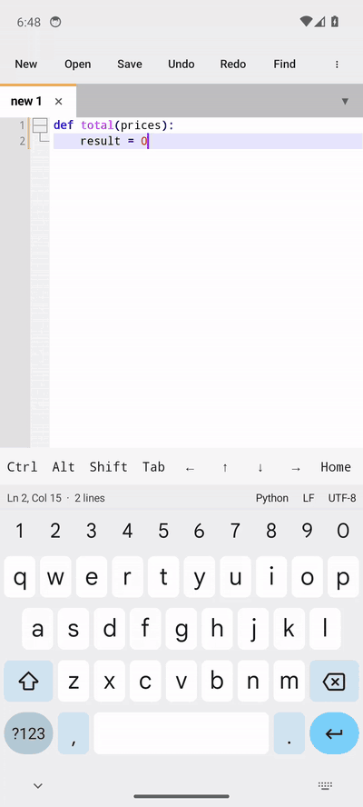 | 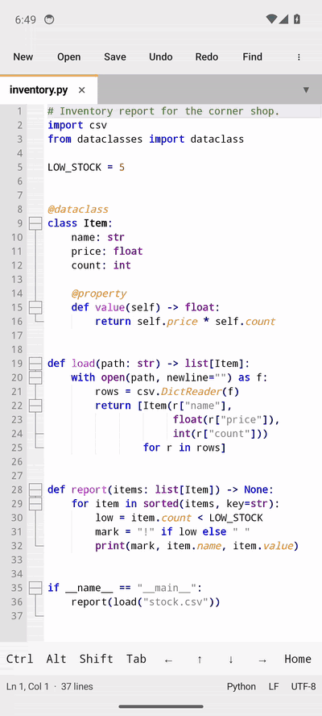 | 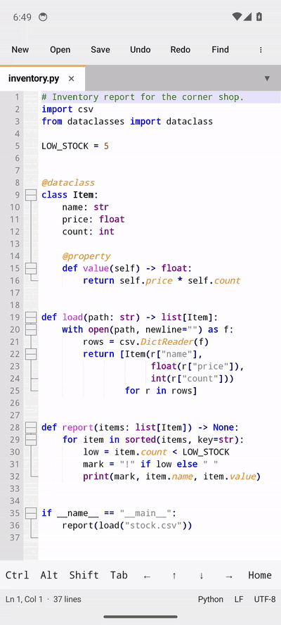 |
| **Typing code.** Highlighting, auto-indent, completions above the keyboard, Ctrl+D with the sticky Ctrl key, and Notepad++'s menus one level at a time | **Reading code.** Fold All, dark mode, and the Function List | **Find and replace** above the keyboard, with a count of matches |
|  | 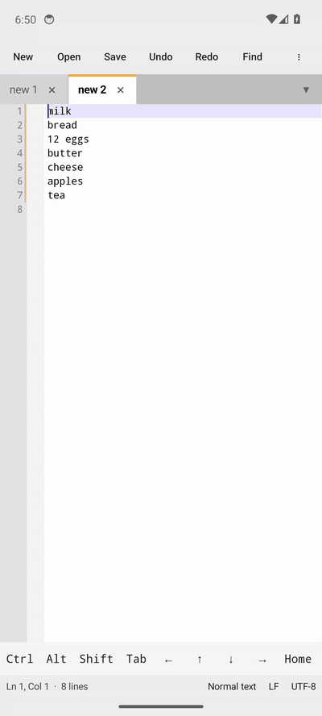 | 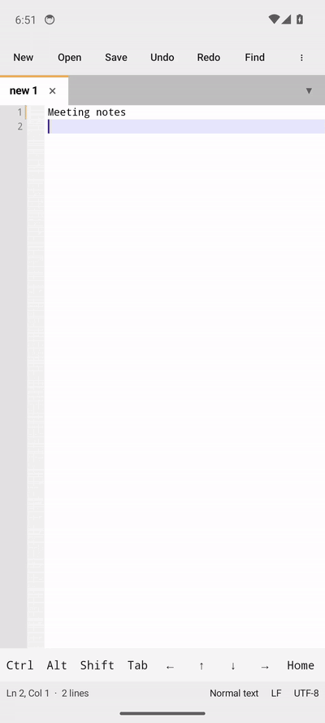 |
| **Several places at once.** A column of carets by dragging with Alt held, then Multi-select All | **Compare and the Hex Editor**, the plugins people ask for first, built in | **Scripting in Lua.** A line in the console, then a script that adds a command to the menu |

<details>
<summary>Screenshots</summary>

| | | |
|:---:|:---:|:---:|
| 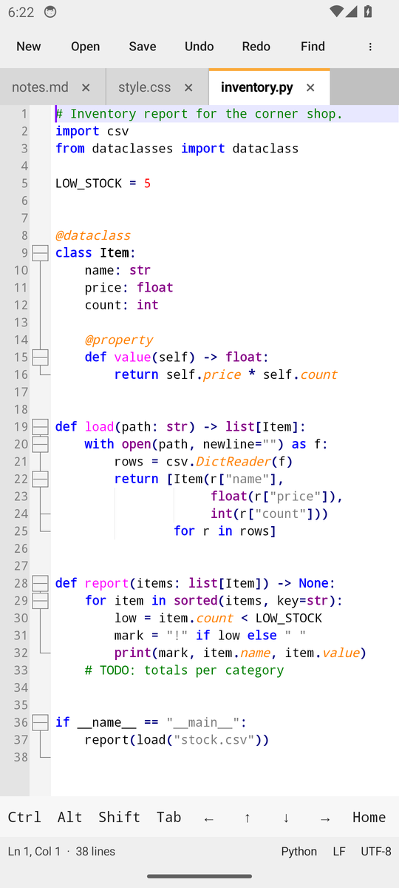 | 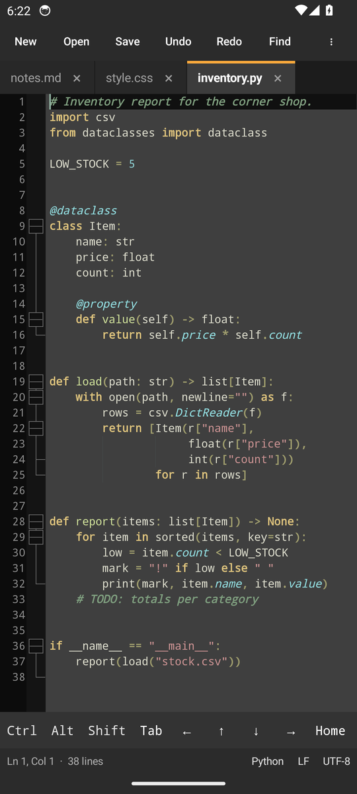 | 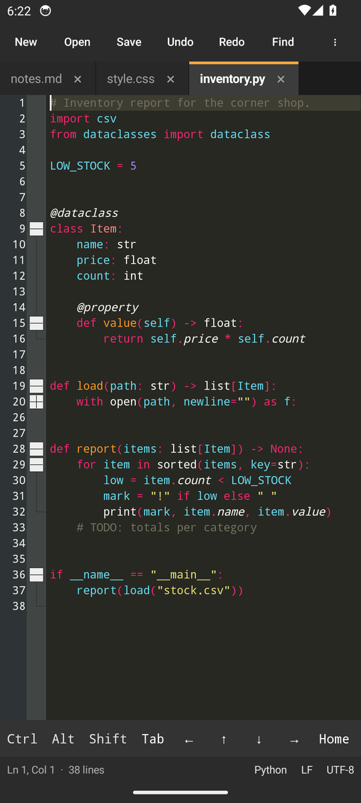 |
| Notepad++'s default theme | Dark mode | 22 more Notepad++ themes |
| 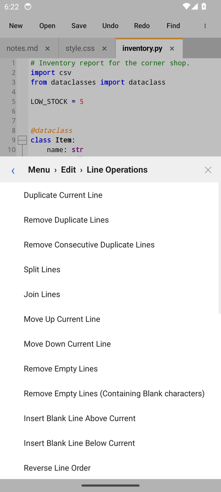 | 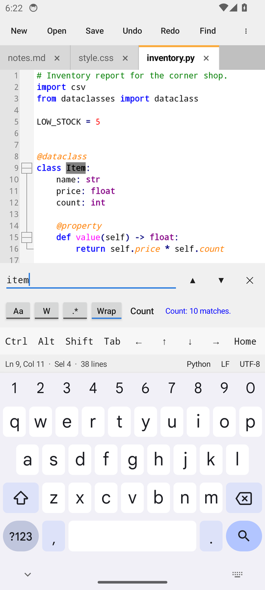 | 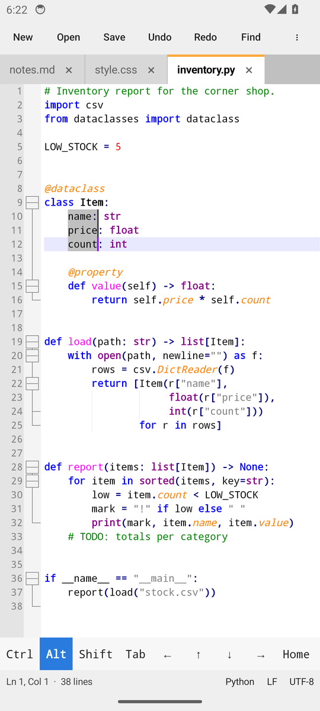 |
| Notepad++'s menus, one level at a time | Find and replace above the keyboard | Column selection with the Alt key |
| 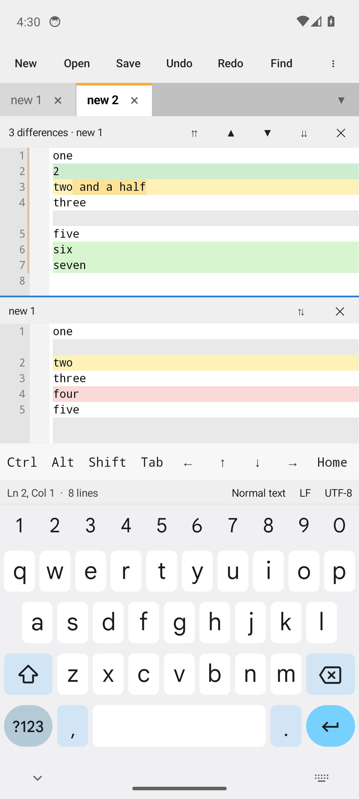 | 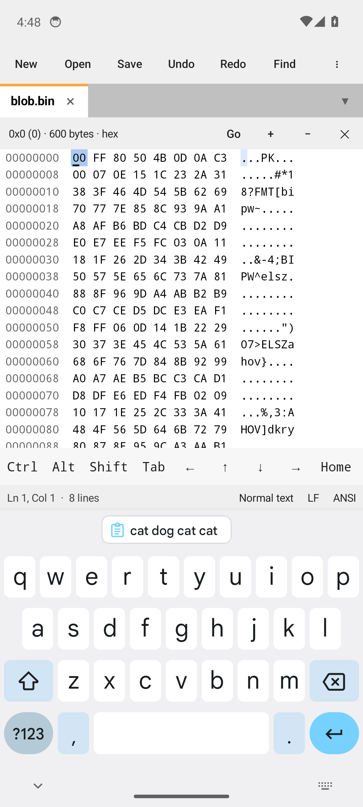 | 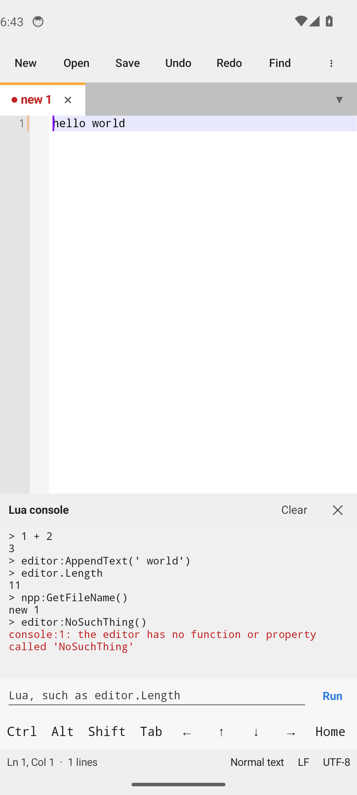 |
| Compare | Hex Editor | The Lua console |

</details>

## Contents

- [Why](#why)
- [Install](#install) and [checking a download](#checking-a-download)
- [Finding your way around](#finding-your-way-around)
- [What works today](#what-works-today)
- [Plugins](#plugins)
- [Keyboard shortcuts](#keyboard-shortcuts)
- [Where it differs from Notepad++](#where-it-differs-from-notepad)
- [What is not there yet](#what-is-not-there-yet)
- [Privacy and permissions](#privacy-and-permissions)
- [How it is put together](#how-it-is-put-together), [build and test](#build-and-test)
- [Contributing](#contributing), [credits](#credits), [licence](#licence)

## Why

Notepad++ is the editor many people reach for on Windows, and nothing on Android feels like it.
Pocketpad++ aims to be that editor on a phone or tablet: every Notepad++ feature that can work on Android,
under the menu names and shortcuts you already know, plus what a touch screen needs.

It does this by reusing what Notepad++ is made of rather than imitating it:

- **Scintilla and Lexilla**, the editing engine and lexers Notepad++ uses, in the same versions,
  ported to Android with a platform layer written for this project.
- **Notepad++'s own language and style definitions** (`langs.model.xml`, `stylers.model.xml` and its themes),
  so keywords, file associations and colours match.
- **Notepad++'s menu structure**, read from its menu resource and tracked command by command in the
  [feature map](docs/FEATURES.md): 469 of its 481 menu commands are in, and the other 12 only make sense on Windows.

## Install

1. On your phone, open the [dev-latest pre-release](../../releases/tag/dev-latest) and download `pocketpadpp-dev.apk`.
2. Open the downloaded file. Android asks once whether your browser or file manager may install apps; allow it.
3. To update, do the same again: a newer build installs over the older one and keeps your open tabs and settings.

It needs Android 8.0 or newer on a 64-bit device.

These are development builds, made automatically from every change. There is no store release yet.

### Checking a download

Every build is made by GitHub's servers from the source in this repository, not on anyone's own computer,
and two things are published with it so that you can check the file you have.

**Its SHA-256 checksum.** The release page shows it, and has it as the file `pocketpadpp-dev.apk.sha256`.
If your file gives the same checksum, it is the published file, whole and unchanged:

```sh
sha256sum pocketpadpp-dev.apk       # Linux; "shasum -a 256" on macOS, "Get-FileHash" in PowerShell
```

On a phone, many file managers show a file's SHA-256 under its details or properties.

**A signed statement of where it was built.** For each APK, GitHub records that this exact file (by its
SHA-256) was built by this repository's own workflow, and from which commit. This is a
[GitHub artifact attestation](https://docs.github.com/en/actions/how-tos/secure-your-work/use-artifact-attestations/use-artifact-attestations).
It is signed with a short-lived certificate issued to that one run of the workflow, not with a key this
project keeps, and it is recorded in a public transparency log. To check a file against it you need the
[GitHub CLI](https://cli.github.com/), version 2.49 or newer and signed in to any account:

```sh
gh attestation verify pocketpadpp-dev.apk --repo revelationnow/pocketpadpp
```

This succeeds only for a file that came out of this repository's build, wherever you got your copy from:
this page, a mirror, or a friend. Add `--source-digest` and a commit id to ask for one particular commit.
Every build runs this check on itself before it is published, and the repository's Actions tab lists
the statements under [Attestations](../../attestations).

**What the app's signature does not tell you.** Android apps are signed, and Android only lets an update
replace an app signed with the same key. The development builds are signed with a key that is kept in this
repository in the open, so that every build can update the one before. That key therefore proves nothing
about who made a file; the two checks above are what to rely on. A store release, when there is one, will
be signed with a key that is not public.

## Finding your way around

| Part of the screen | What it is for |
|---|---|
| **Toolbar** at the top | New, Open, Save, Undo, Redo, Find, and **⋮** for the menu |
| **Tabs** under it | One per open document. A dot marks unsaved changes; press and hold a tab for its own menu; **▼** lists every tab |
| **The menu** (⋮) | Notepad++'s menus: File, Edit, Search, View, Encoding, Language, Settings, Tools, Macro, Run, Plugins, Window, ?. It opens from the bottom and shows one level at a time, with a back arrow, and the shortcut beside each command |
| **Extra keys** above the keyboard | Ctrl, Alt, Shift, Tab, the arrows, Home, End and the symbols code needs |
| **Status bar** at the bottom | Line and column, what is selected, and three things you can tap to change: language, line ending, encoding |
| **Side panel** (View menu) | Document List, Folder as Workspace, Function List and the Project Panels, each a tab of one panel that slides in from the left |

Things that work differently on a touch screen than you might expect:

- **Ctrl, Alt and Shift are sticky.** One tap holds the key for the next key press, a second tap locks it,
  a third releases it. Tap Ctrl and then `s` on the keyboard to save; tap Alt and then `f` to open the File menu.
  They also work with the arrow keys in the row and with a Bluetooth or USB keyboard.
- **Gestures:** tap to place the caret, double tap for a word, press and hold then drag to select, drag the
  handles to adjust, pinch to zoom, and drag the scroll thumb to get around a long file.
- **Column selection:** tap Alt, then drag across the text.
- **Completions appear where a keyboard shows suggestions:** in a row above the keys, not in a list under your thumb.
- **Keyboard suggestions and autocorrect are off by default,** as they get in the way of code. Turn them on
  in Settings for writing prose.
- **Your work survives closing the app.** Open tabs come back, including text you never saved.

## What works today

**Editing**
- Syntax highlighting and folding for 94 languages, with Notepad++'s keywords and file extensions
- Multiple carets and multi-select (all / next occurrence, with case and whole-word variants)
- Column selection by touch or keyboard, and the Column Editor (text or number series)
- Line operations: duplicate, move, join, split, remove duplicates and empty lines, reverse, shuffle,
  and 14 kinds of sort
- Case conversion (upper, lower, proper, sentence, invert, random), comment and uncomment,
  trimming and tab/space conversion
- Auto-indent, brace highlighting and go to matching brace, bookmarks, read-only mode, redact selection
- Auto-completion from the words of the document and from Notepad++'s function lists for 34 languages,
  with hints for the parameters of the function being called
- Unlimited undo and redo, kept per tab

**Files**
- Tabs, with a session that brings back open files and unsaved text after the app is closed
- Open, save, save as, save a copy, reload, recent files, and "Open with" from other apps
- Pinned tabs, monitoring a log file as it grows (tail -f), printing and saving as PDF through Android's print screen
- UTF-8, UTF-8 with BOM, UTF-16 LE/BE and ANSI, detected on load and kept on save, plus 46 character sets to choose from
- Windows, Unix and old Mac line endings, shown and convertible from the status bar

**Search**
- Find, find previous, count and replace above the keyboard
- Match case, whole word, wrap around and regular expressions with groups
- Find the selection or the word under the caret, incremental search, find characters in a range, go to line
- Marks: highlight every occurrence in one of five colours, jump between them, copy them;
  mark everything a search finds and bookmark those lines
- Bookmarks, with cut, copy, replace and remove for all bookmarked lines at once
- Find All in the current document or in every open one, and Find in Files over a folder with file filters,
  with a results panel that jumps to each hit

**View**
- Notepad++'s default theme, dark mode and 22 further themes; the app around the editor turns light or dark to match
- Word wrap, show spaces / tabs / line endings / indent guides, zoom, line numbers, fold levels
- Hide lines, full screen and distraction free mode
- Right-to-left text direction
- Document summary

**Panels**
- Document List: every open document
- Folder as Workspace: folders you add, as a tree whose files open with a tap
- Function List: the functions and classes of the document, from Notepad++'s own rules for 47 languages
- Project Panels 1 to 3: projects, folders and files kept as Notepad++ workspace files
- Document Map: the whole document in tiny print beside the editor; touch it to go there
- Split screen: a second view of the same or another document for reading, scrolling in step if you like,
  and a second window for a file of its own

**Languages of your own**
- Notepad++'s user-defined language files (UDL) work as they are: import them, edit them, export them
- Markdown is highlighted out of the box, with the definitions Notepad++ itself ships

**Macros and Run**
- Record typing and editing keys, play the recording back once, a number of times or to the end of the file,
  and save macros under a name
- Run opens an address with the current word or file name filled in

**Settings**
- Preferences for tab size, spaces instead of tabs, auto-indent, caret, vertical edge, and the line ending
  and encoding of new documents
- Shortcut Mapper: any menu command can be given a shortcut, and the menus show them
- Style Configurator: the font, and the colours and font style of any style in the theme
- Import Notepad++ theme files, and choose extra commands for the selection toolbar

**Tools and windows**
- MD5, SHA-1, SHA-256 and SHA-512 of a text, of files, or of the selection
- Sort the tabs by name, path, type, size or time, colour them, and jump to any open document from a list

## Plugins

Notepad++ plugins are Windows libraries and cannot run on Android, so the ones people use most are built
into the app, under a Plugins menu of their own.

| Plugin | What it does |
|---|---|
| **Compare** | Two documents one above the other, with added, removed and changed lines tinted, the changed characters marked, and blank rows keeping the two level. Next and previous difference; compare with the clipboard or with the file as last saved; ignore case or spaces; the comparison follows your typing |
| **Hex Editor** | Any document as bytes, in hex and as text side by side. A saved file is shown and saved back byte for byte, so files that are not text stay intact. Overwrite, insert and delete bytes, undo, go to an offset, find bytes or text |
| **Lua Script** | Write your own commands. A real Lua 5.4 with the `editor` and `npp` objects of Notepad++'s LuaScript plugin: every Scintilla function, menu commands, shortcuts, and handlers for events such as saving a file. With a console, a startup script and six examples to start from. See [docs/LUA.md](docs/LUA.md) |

A taste of scripting, from the examples that come with the app:

```lua
-- Adds "Insert Date" to Plugins > Lua Script, with a shortcut.
npp.AddShortcut("Insert Date", "Ctrl+Alt+D", function()
    editor:ReplaceSel(os.date("%Y-%m-%d"))
end)

-- Takes the spaces off line ends whenever a file is saved.
npp.AddEventHandler("OnBeforeSave", function(filename)
    for m in editor:match("[ \t]+$", SCFIND_REGEXP) do m:replace("") end
end)
```

## Keyboard shortcuts

The shortcuts are Notepad++'s defaults. Use them with the sticky keys or a Bluetooth / USB keyboard,
and change them in Settings > Shortcut Mapper.

| Shortcut | Command | Shortcut | Command |
|---|---|---|---|
| Ctrl+N / O / S | New / Open / Save | Ctrl+Z / Y | Undo / Redo |
| Ctrl+Alt+S | Save As | Ctrl+X / C / V / A | Cut / Copy / Paste / Select All |
| Ctrl+Shift+S | Save All | Ctrl+D | Duplicate line |
| Ctrl+W, Ctrl+Shift+W | Close, Close All | Ctrl+L | Cut line |
| Ctrl+Tab, Ctrl+Shift+Tab | Next / previous tab | Ctrl+J / Ctrl+I | Join / split lines |
| Ctrl+F / Ctrl+H | Find / Replace | Ctrl+Shift+Up / Down | Move line up / down |
| F3 / Shift+F3 | Find next / previous | Ctrl+Q | Toggle line comment |
| Ctrl+F3 | Select and find next | Ctrl+K / Ctrl+Shift+K | Comment / uncomment lines |
| Ctrl+G | Go to line | Ctrl+Shift+Q | Block comment |
| Ctrl+B | Go to matching brace | Ctrl+U / Ctrl+Shift+U | lowercase / UPPERCASE |
| Ctrl+F2, F2, Shift+F2 | Toggle / next / previous bookmark | Alt+C | Column Editor |
| Alt+0, Alt+Shift+0 | Fold all, unfold all | Alt+Shift+arrows | Column selection |
| Alt+1…8, Alt+Shift+1…8 | Fold / unfold a level | Ctrl+arrows | Move by word |
| Ctrl+Alt+F | Fold current level | Ctrl + `+` / `-` / `/` | Zoom in / out / reset |
| Ctrl+Shift+F | Find in Files | F4 / Shift+F4 | Next / previous search result |
| Ctrl+Shift+R / Ctrl+Shift+P | Record / play a macro | F7 | Search results panel |
| Ctrl+P | Print | F5 | Run |
| Alt+F / E / S / V / N / L / T / P | Open the File / Edit / Search / View / Encoding / Language / Settings / Plugins menu | Alt+PgUp / PgDn | Previous / next difference (Compare) |

## Where it differs from Notepad++

The commands are Notepad++'s, but a phone is not a desktop, and a few things are done another way.

| In Notepad++ | In Pocketpad++ |
|---|---|
| A menu bar with nested pop-up menus | One menu that opens from the bottom and shows a level at a time |
| Panels docked around the editor | One side panel that slides in, with a tab per panel |
| Two views that can both be typed in | The second view is for reading and copying; Focus on Another View swaps the two |
| Plugins loaded from DLLs | Compare, Hex Editor and Lua scripting built in |
| An auto-completion list at the caret | Candidates in a row above the keyboard |
| Run starts a program | Run opens an address or another app; Android does not let apps start programs |
| A dialog for defining a language | The language's definition file is edited as XML |
| Boost regular expressions | ECMAScript regular expressions for now (no lookbehind) |
| Open and Save dialogs | Android's file picker, which lends the app the files you choose |
| Right-to-left by mirroring the window | The same, by mirroring the editor |

## What is not there yet

The [feature map](docs/FEATURES.md) lists every Notepad++ command with its status. The larger pieces still to come:

| Area | Planned |
|---|---|
| Search | Notepad++'s regular expression syntax in Find and Replace |
| Languages | A form for defining a language, in place of editing its XML |
| Plugins | More of the popular plugins, built in the same way |
| Hex Editor | Selecting, copying and pasting bytes |

Known gaps in what exists are listed in [docs/TESTING.md](docs/TESTING.md#known-gaps). The ones you are most
likely to meet: folds are not remembered across restarts, files over 64 MB are refused, the second view of
the split screen is for reading, and a Lua script that runs for more than five seconds is stopped.

## Privacy and permissions

The app asks Android for no permissions at all. In particular it has no internet access of its own, so it
cannot send your files anywhere, and it shows no ads and collects nothing. Files are opened through Android's
file picker, which gives the app the files you choose and no others. Links in the ? menu, Run and Search on
Internet hand an address to your browser. Lua scripts run inside the same limits.

## How it is put together

| Path | What |
|---|---|
| `third_party/` | Scintilla 5.6.9 and Lexilla 5.5.5, unmodified, as shipped in Notepad++, and Lua 5.4.8 |
| `app/src/main/cpp/` | Scintilla platform layer for Android (C++), including soft keyboard text handling, and the Lua bridge |
| `app/src/main/java/.../scintilla/` | The JNI boundary: a few small Java interfaces, native entry points, generated constants |
| `app/src/main/kotlin/.../editor/` | `ScintillaView`: drawing, touch scrolling, selection handles, gestures, input connection |
| `app/src/main/kotlin/.../core/` | Application logic without Android classes: encodings, Notepad++ language and theme import, search, edit commands, sessions, the function list, diff, the hex buffer, the Lua engine |
| `app/src/main/kotlin/.../app/`, `MainActivity.kt` | Tabs, file access, find bar, menus, panels, shortcuts |
| `app/src/main/assets/npp/` | Notepad++'s language definitions, themes, function list rules and auto-completion files |
| `app/src/main/assets/lua/` | The scripting layer (itself written in Lua), tables generated from Scintilla's interface, and the examples |
| `hosttest/` | Tests that run the native layer and the application logic on a desktop JVM, with Java2D standing in for the Android canvas |
| `app/src/androidTest/` | The walkthrough that drives the app on an emulator, and the scenes the clips above are recorded from |
| `tools/` | Generators for Scintilla constants, the language table, the feature map, the Lua interface and the logo; scripts for the tests and recordings |

The native layer talks to Android only through JNI interfaces (font, surface, platform, host), which keeps
it free of NDK dependencies and lets the same code be tested off-device.

## Build and test

Android Studio (Ladybug or newer) opens the project directly. From a shell:

```sh
./gradlew assembleRelease      # needs the Android SDK, NDK 27.3 and CMake 3.31
hosttest/run.sh                # desktop tests; needs a JDK, CMake, Ninja, a C++17 compiler and kotlinc
tools/run_ui_tests.sh          # walkthrough on a running emulator or connected phone
tools/record_demos.sh          # records the clips above; with ffmpeg, also makes the GIFs
```

Three sets of tests run on every push: 81 checks on the native layer and about 780 on the application logic,
both on a desktop JVM against the real Scintilla and Lua, and 38 walkthroughs that drive the real app on an
Android emulator through typing, menus, settings, themes, tabs, files, search, gestures, shortcuts and the
plugins, saving a screenshot at each step. The screenshots above come from it. See [docs/TESTING.md](docs/TESTING.md).

## Contributing

Bug reports are welcome, especially about keyboards: they differ a lot in how they talk to an editor.
Turn on **Menu > Settings > Keyboard log**, reproduce the problem, tap the log to copy it, and paste it
into the issue together with the name of your keyboard app.

Scripts are welcome too: a Lua script that others would find useful can join the examples.

## Credits

- [Notepad++](https://notepad-plus-plus.org/) by Don Ho and contributors, for the editor this project follows,
  and for its language definitions, themes and user-defined-language lexer, which are used here under the GPL.
  Its function list rules, auto-completion files and function list test files are used the same way.
- [Scintilla and Lexilla](https://www.scintilla.org/) by Neil Hodgson and contributors, the editing engine and lexers.
- [Lua](https://www.lua.org/) by Roberto Ierusalimschy, Luiz Henrique de Figueiredo and Waldemar Celes (MIT licence).
- [LuaScript](https://github.com/dail8859/LuaScript) by Justin Dailey, the Notepad++ plugin whose scripting
  interface the Lua layer follows, and SciTE's Lua extension before it.
- [ComparePlus](https://github.com/pnedev/comparePlus) and the HEX-Editor plugin, whose behaviour the built-in
  Compare and Hex Editor are modelled on. Their code is not used.
- [Markdown-plus-plus](https://github.com/Edditoria/markdown-plus-plus) by Edditoria (MIT licence), the Markdown
  language definitions that Notepad++ ships and that come with this app too.

The Pocketpad++ name and logo are this project's own. "Notepad++" is the name of the original project and is
used here only to describe what Pocketpad++ is modelled on.

## Licence

AGPL-3.0, see [LICENSE](LICENSE). Scintilla, Lexilla, Lua and the Notepad++ data files keep their own licences,
see [third_party/README.md](third_party/README.md).
