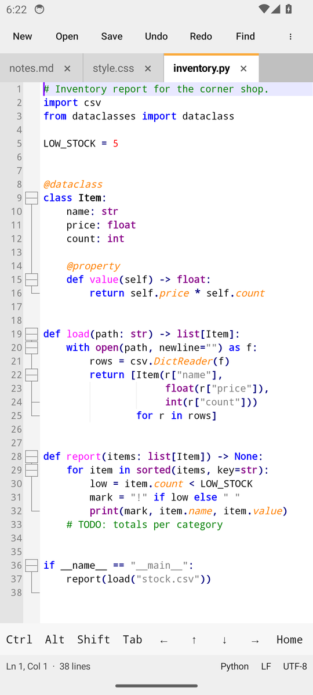
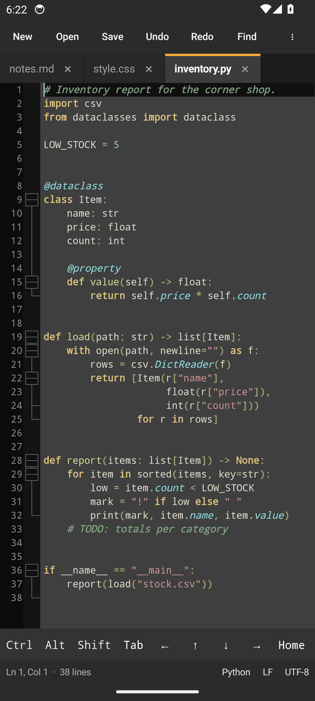
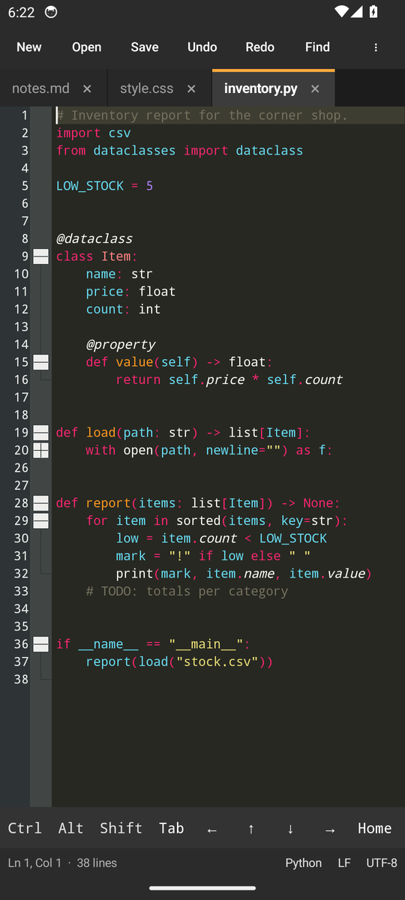
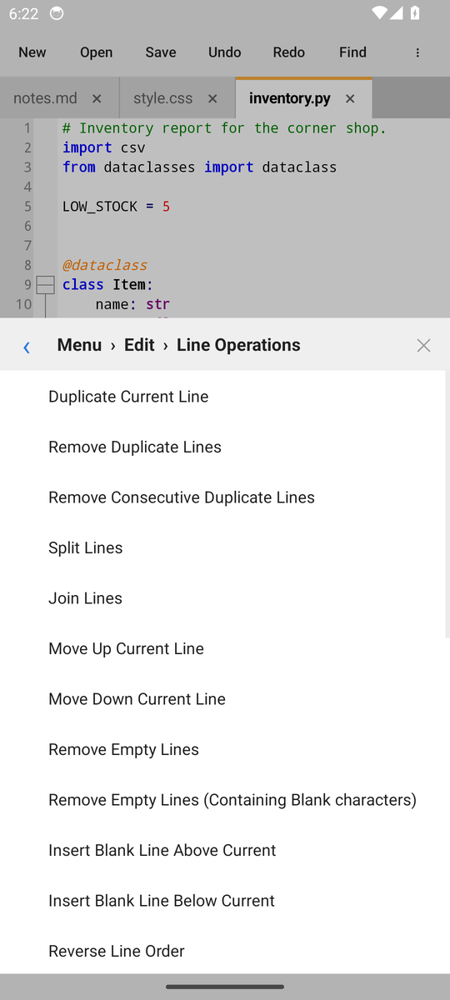
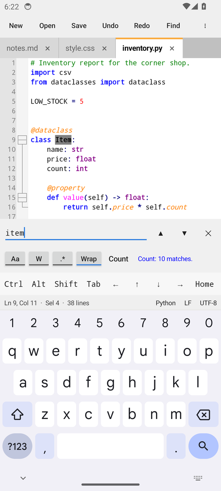
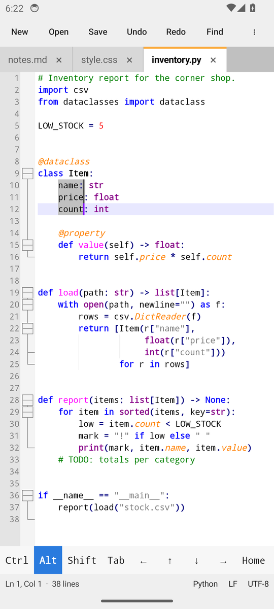
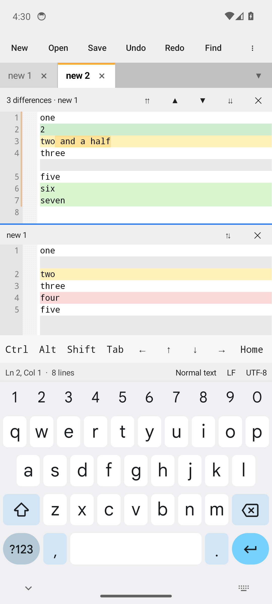
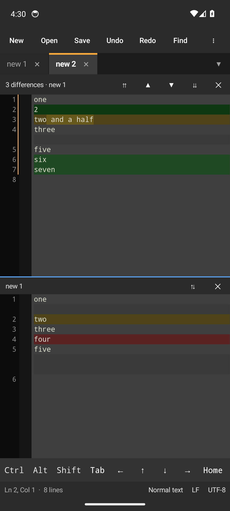
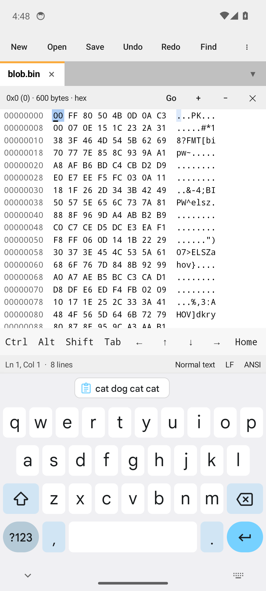

<p align="center">
  
</p>

<h1 align="center">Pocketpad++</h1>

<p align="center">
  A free, open-source text and code editor for Android in the spirit of Notepad++,<br>
  built on the same editing engine and with the same languages, themes, menus and shortcuts.
</p>

<p align="center">
  <a href="../../releases/tag/dev-latest"><b>Download the latest build</b></a> ·
  <a href="docs/FEATURES.md">Feature map</a> ·
  <a href="docs/TESTING.md">Testing</a>
</p>

Pocketpad++ is an independent project. It is not affiliated with or endorsed by the Notepad++ project;
see [Credits](#credits) for what it owes to it.

| | | |
|:---:|:---:|:---:|
|  |  |  |
| Notepad++'s default theme | Dark mode | 22 more Notepad++ themes |
|  |  |  |
| Notepad++'s menus, one level at a time | Find and replace above the keyboard | Column selection with the Alt key |
|  |  |  |
| Compare, built in | Compare in dark mode | Hex Editor, built in |

## Why

Notepad++ is the editor many people reach for on Windows, and nothing on Android feels like it.
Pocketpad++ aims to be that editor on a phone or tablet: every Notepad++ feature that can work on Android,
under the menu names and shortcuts you already know, plus what a touch screen needs.

It does this by reusing what Notepad++ is made of rather than imitating it:

- **Scintilla and Lexilla**, the editing engine and lexers Notepad++ uses, in the same versions,
  ported to Android with a platform layer written for this project.
- **Notepad++'s own language and style definitions** (`langs.model.xml`, `stylers.model.xml` and its themes),
  so keywords, file associations and colours match.
- **Notepad++'s menu structure**, read from its menu resource and tracked command by command in the
  [feature map](docs/FEATURES.md).

## What works today

469 of the 481 commands in Notepad++'s menus are implemented; the other 12 are tied to Windows. In short:

**Editing**
- Syntax highlighting and folding for 94 languages, with Notepad++'s keywords and file extensions
- Multiple carets and multi-select (all / next occurrence, with case and whole-word variants)
- Column selection by touch or keyboard, and the Column Editor (text or number series)
- Line operations: duplicate, move, join, split, remove duplicates and empty lines, reverse, shuffle,
  and 14 kinds of sort
- Case conversion (upper, lower, proper, sentence, invert, random), comment and uncomment,
  trimming and tab/space conversion
- Auto-indent, brace highlighting and go to matching brace, bookmarks, read-only mode, redact selection
- Auto-completion from the words of the document and from Notepad++'s function lists for 34 languages,
  shown in a row above the keyboard, with hints for the parameters of the function being called
- Unlimited undo and redo, kept per tab

**Files**
- Tabs, with a session that brings back open files and unsaved text after the app is closed
- Open, save, save as, save a copy, reload, recent files, and "Open with" from other apps
- Pinned tabs, monitoring a log file as it grows (tail -f), printing and saving as PDF through Android's print screen
- UTF-8, UTF-8 with BOM, UTF-16 LE/BE and ANSI, detected on load and kept on save, plus 46 character sets to choose from
- Windows, Unix and old Mac line endings, shown and convertible from the status bar

**Search**
- Find, find previous, count and replace above the keyboard
- Match case, whole word, wrap around and regular expressions with groups
- Find the selection or the word under the caret, incremental search, find characters in a range, go to line
- Marks: highlight every occurrence in one of five colours, jump between them, copy them;
  mark everything a search finds and bookmark those lines
- Bookmarks, with cut, copy, replace and remove for all bookmarked lines at once
- Find All in the current document or in every open one, and Find in Files over a folder with file filters,
  with a results panel that jumps to each hit

**View**
- Notepad++'s default theme, dark mode and 22 further themes; the app around the editor turns light or dark to match
- Word wrap, show spaces / tabs / line endings / indent guides, zoom, line numbers, fold levels
- Hide lines, full screen and distraction free mode
- Right-to-left text direction
- Document summary

**Panels**
- One panel slides in from the left with a tab for each of Notepad++'s docked panels
- Document List: every open document
- Folder as Workspace: folders you add, as a tree whose files open with a tap
- Function List: the functions and classes of the document, from Notepad++'s own rules for 47 languages
- Project Panels 1 to 3: projects, folders and files kept as Notepad++ workspace files
- Document Map: the whole document in tiny print beside the editor; touch it to go there
- Split screen: a second view of the same or another document for reading, scrolling in step if you like,
  and a second window for a file of its own

**Languages of your own**
- Notepad++'s user-defined language files (UDL) work as they are: import them, edit them, export them
- Markdown is highlighted out of the box, with the definitions Notepad++ itself ships

**Plugins**
- Notepad++'s best-known plugins are built in, under a Plugins menu of their own
- Lua Script: write your own commands. A real Lua 5.4 with the `editor` and `npp` objects of Notepad++'s
  LuaScript plugin, a console, a startup script, commands with shortcuts and handlers for events such as
  saving a file. See [docs/LUA.md](docs/LUA.md)
- Compare: two documents one above the other with added, removed and changed lines tinted, the changed
  characters marked and blank rows keeping the two level; next / previous difference, compare with the
  clipboard or with the file as last saved, ignore case or spaces, and the comparison follows your typing
- Hex Editor: any document as bytes, in hex and as text side by side. A saved file is shown and saved back
  byte for byte, so files that are not text stay intact. Overwrite, insert and delete bytes, undo, go to
  an offset, find bytes or text

**Macros and Run**
- Record typing and editing keys, play the recording back once, a number of times or to the end of the file,
  and save macros under a name
- Run opens an address with the current word or file name filled in

**Settings**
- Preferences for tab size, spaces instead of tabs, auto-indent, caret, vertical edge, and the line ending
  and encoding of new documents
- Shortcut Mapper: any menu command can be given a shortcut, and the menus show them
- Style Configurator: the font, and the colours and font style of any style in the theme
- Import Notepad++ theme files, and choose extra commands for the selection toolbar

**Tools and windows**
- MD5, SHA-1, SHA-256 and SHA-512 of a text, of files, or of the selection
- Sort the tabs by name, path, type, size or time, colour them, and jump to any open document from a list

## Made for touch

- **An extra row of keys** above the keyboard: Tab, arrows, Home, End and the symbols code needs.
- **Sticky Ctrl, Alt and Shift keys.** One tap holds a key for the next key press, a second tap locks it,
  a third releases it. They work with the on-screen keyboard, the arrow keys in the row and hardware keyboards.
- **Gestures:** tap to place the caret, double tap for a word, long press and drag to select, handles to adjust,
  pinch to zoom, and a scroll thumb to get around long files.
- **Column selection:** hold Alt and drag.
- **One menu, one level at a time,** with a back arrow at every level instead of nested pop-ups.
- **A tappable status bar** for line endings, encoding, language and go to line.
- **Completions where a keyboard shows suggestions:** in a row above the keys, not in a list under your thumb.
- **A choice of keyboards:** suggestions and autocorrect are off by default, as they get in the way of code,
  and can be turned on in Settings for writing prose.

## Keyboard shortcuts

The shortcuts are Notepad++'s defaults. Use them with the sticky keys or a Bluetooth / USB keyboard,
and change them in Settings > Shortcut Mapper.

| Shortcut | Command | Shortcut | Command |
|---|---|---|---|
| Ctrl+N / O / S | New / Open / Save | Ctrl+Z / Y | Undo / Redo |
| Ctrl+Alt+S | Save As | Ctrl+X / C / V / A | Cut / Copy / Paste / Select All |
| Ctrl+Shift+S | Save All | Ctrl+D | Duplicate line |
| Ctrl+W, Ctrl+Shift+W | Close, Close All | Ctrl+L | Cut line |
| Ctrl+Tab, Ctrl+Shift+Tab | Next / previous tab | Ctrl+J / Ctrl+I | Join / split lines |
| Ctrl+F / Ctrl+H | Find / Replace | Ctrl+Shift+Up / Down | Move line up / down |
| F3 / Shift+F3 | Find next / previous | Ctrl+Q | Toggle line comment |
| Ctrl+F3 | Select and find next | Ctrl+K / Ctrl+Shift+K | Comment / uncomment lines |
| Ctrl+G | Go to line | Ctrl+Shift+Q | Block comment |
| Ctrl+B | Go to matching brace | Ctrl+U / Ctrl+Shift+U | lowercase / UPPERCASE |
| Ctrl+F2, F2, Shift+F2 | Toggle / next / previous bookmark | Alt+C | Column Editor |
| Alt+0, Alt+Shift+0 | Fold all, unfold all | Alt+Shift+arrows | Column selection |
| Alt+1…8, Alt+Shift+1…8 | Fold / unfold a level | Ctrl+arrows | Move by word |
| Ctrl+Alt+F | Fold current level | Ctrl + `+` / `-` / `/` | Zoom in / out / reset |
| Ctrl+Shift+F | Find in Files | F4 / Shift+F4 | Next / previous search result |
| Ctrl+Shift+R / Ctrl+Shift+P | Record / play a macro | F7 | Search results panel |
| Ctrl+P | Print | F5 | Run |
| Alt+F / E / S / V / N / L / T | Open the File / Edit / Search / View / Encoding / Language / Settings menu | | |

## Install

Every push builds an APK. Open the [dev-latest pre-release](../../releases/tag/dev-latest) on your phone,
download `pocketpadpp-dev.apk` and install it. It needs Android 8.0 or newer on a 64-bit device.

These are development builds, signed with the public development key in this repository so that each
build updates the previous one. They are not store releases, and Android will ask you to allow installing
from your browser or file manager.

## What is not there yet

The [feature map](docs/FEATURES.md) lists every Notepad++ command with its status. The larger pieces still to come:

| Area | Planned |
|---|---|
| Search | Notepad++'s regular expression syntax in Find and Replace |
| Languages | A form for defining a language, in place of editing its XML |
| Plugins | Notepad++ plugins are Windows libraries and cannot run as they are. Compare, the Hex Editor and Lua scripting are built in; more of the popular plugins can follow the same way |

Known gaps in what exists are listed in [docs/TESTING.md](docs/TESTING.md#known-gaps). The ones you are most
likely to meet: regular expressions use ECMAScript syntax for now (no lookbehind), folds are not remembered
across restarts, files over 64 MB are refused, and the second view of the split screen is for reading, not typing.

## How it is put together

| Path | What |
|---|---|
| `third_party/` | Scintilla 5.6.9 and Lexilla 5.5.5, unmodified, as shipped in Notepad++, and Lua 5.4.8 |
| `app/src/main/cpp/` | Scintilla platform layer for Android (C++), including soft keyboard text handling |
| `app/src/main/java/.../scintilla/` | The JNI boundary: four small Java interfaces, native entry points, generated constants |
| `app/src/main/kotlin/.../editor/` | `ScintillaView`: drawing, touch scrolling, selection handles, gestures, input connection |
| `app/src/main/kotlin/.../core/` | Application logic without Android classes: encodings, Notepad++ language and theme import, search, edit commands, sessions |
| `app/src/main/kotlin/.../app/`, `MainActivity.kt` | Tabs, file access, find bar, menus, shortcuts |
| `app/src/main/assets/npp/` | Notepad++'s `langs.model.xml`, `stylers.model.xml` and themes, plus a language table generated from its sources |
| `hosttest/` | Tests that run the native layer and the application logic on a desktop JVM, with Java2D standing in for the Android canvas |
| `app/src/androidTest/` | The walkthrough that drives the app on an emulator and saves screenshots |
| `tools/` | Generators for Scintilla constants, the language table, the feature map and the logo |

The native layer talks to Android only through JNI interfaces (font, surface, platform, host), which keeps
it free of NDK dependencies and lets the same code be tested off-device.

## Build and test

Android Studio (Ladybug or newer) opens the project directly. From a shell:

```sh
./gradlew assembleRelease      # needs the Android SDK, NDK 27.3 and CMake 3.31
hosttest/run.sh                # desktop tests; needs a JDK, CMake, Ninja, a C++17 compiler and kotlinc
tools/run_ui_tests.sh          # walkthrough on a running emulator or connected phone
```

Three sets of tests run on every push: about 80 checks on the native layer and 240 on the application logic,
both on a desktop JVM, and a walkthrough that drives the real app on an Android emulator through typing,
menus, settings, themes, tabs, files, search, gestures and shortcuts, saving a screenshot at each step.
The screenshots above come from it. See [docs/TESTING.md](docs/TESTING.md).

## Contributing

Bug reports are welcome, especially about keyboards: they differ a lot in how they talk to an editor.
Turn on **Menu > Settings > Keyboard log**, reproduce the problem, tap the log to copy it, and paste it
into the issue together with the name of your keyboard app.

## Credits

- [Notepad++](https://notepad-plus-plus.org/) by Don Ho and contributors, for the editor this project follows,
  and for its language definitions, themes and user-defined-language lexer, which are used here under the GPL.
  Its function list rules, auto-completion files and function list test files are used the same way.
- [Scintilla and Lexilla](https://www.scintilla.org/) by Neil Hodgson and contributors, the editing engine and lexers.
- [Markdown-plus-plus](https://github.com/Edditoria/markdown-plus-plus) by Edditoria (MIT licence), the Markdown
  language definitions that Notepad++ ships and that come with this app too.

The Pocketpad++ name and logo are this project's own. "Notepad++" is the name of the original project and is
used here only to describe what Pocketpad++ is modelled on.

## Licence

AGPL-3.0, see [LICENSE](LICENSE). Scintilla, Lexilla and the Notepad++ data files keep their own licences,
see [third_party/README.md](third_party/README.md).
